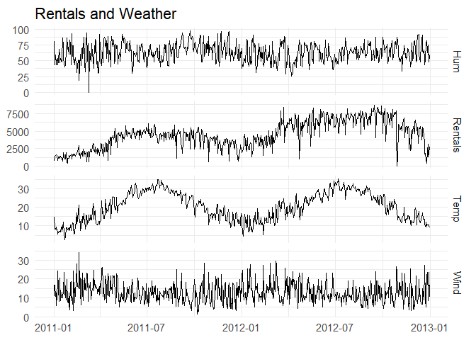
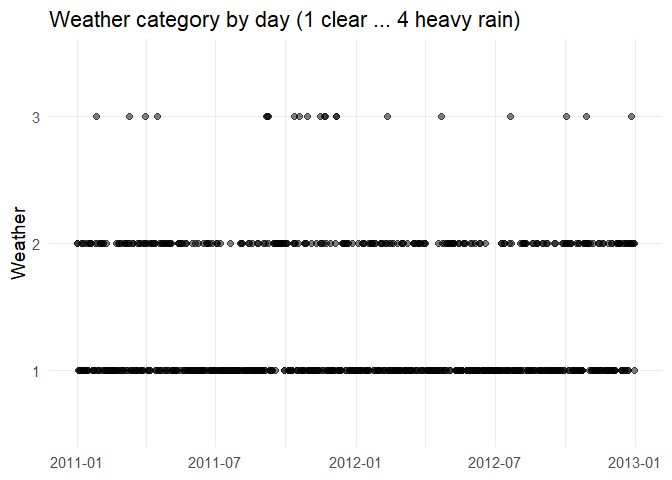
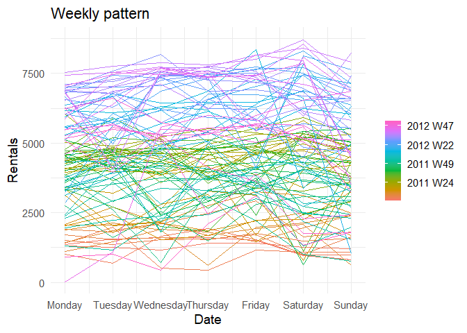
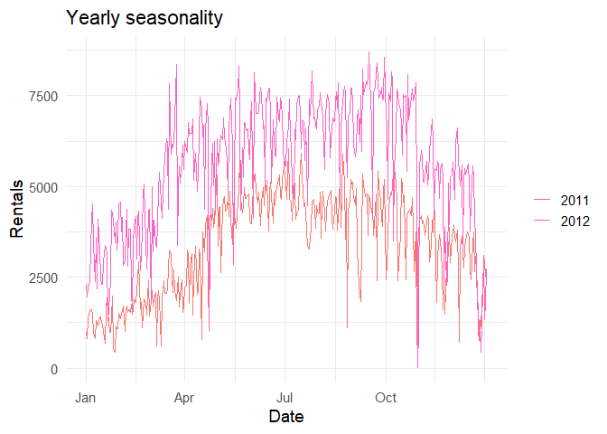
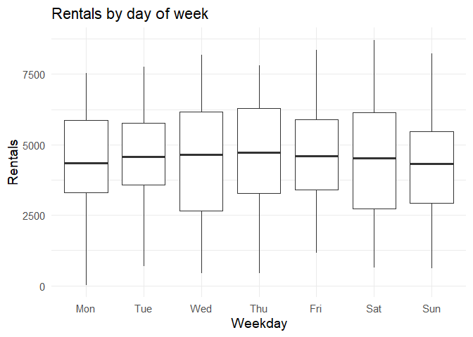
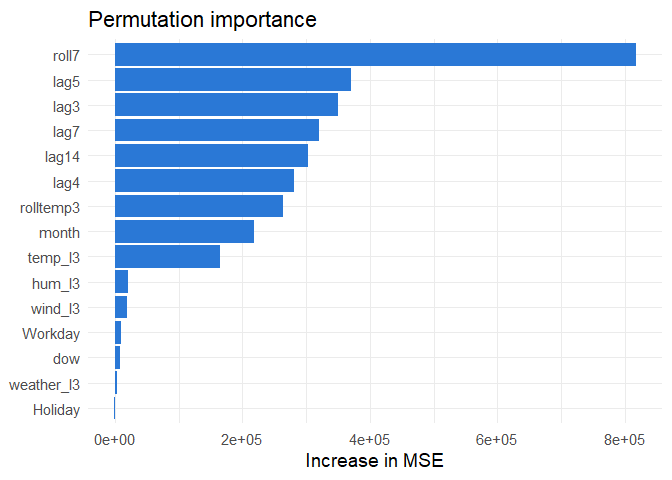
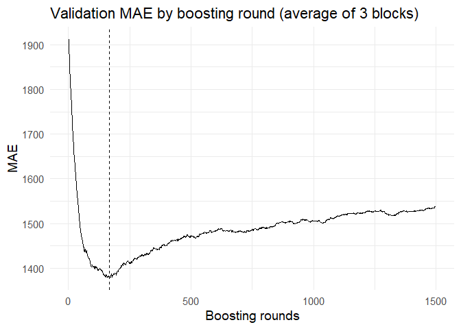
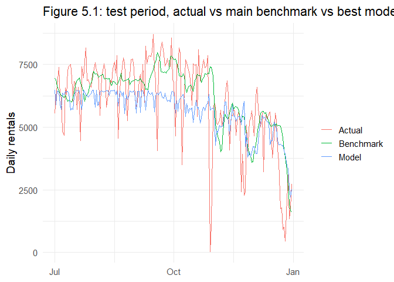
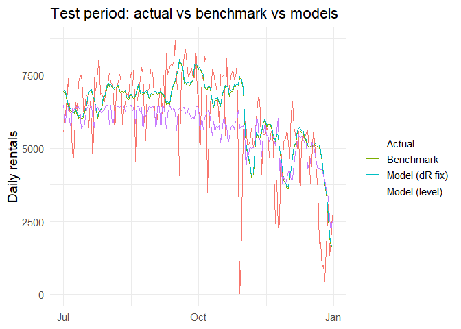

# Dimmig hw5


``` r
library(fpp3)
library(ranger)
library(xgboost)
theme_set(theme_minimal(base_size = 14))
set.seed(2026)
rmse <- function(actual, pred) sqrt(mean((actual - pred)^2))
mae  <- function(actual, pred) mean(abs(actual - pred))

dir <- tempfile(); dir.create(dir)
zipf <- file.path(dir, "bike.zip")
download.file("https://archive.ics.uci.edu/static/public/275/bike+sharing+dataset.zip",
              zipf, method = "curl", quiet = TRUE)
unzip(zipf, exdir = dir)

bike <- readr::read_csv(file.path(dir, "day.csv"), show_col_types = FALSE) |>
  transmute(Date = as.Date(dteday),
            Rentals = cnt,
            Temp = temp * 41,          # the file stores these divided by their maximum
            Hum = hum * 100,
            Wind = windspeed * 67,
            Weather = weathersit,
            Holiday = holiday,
            Workday = workingday) |>
  as_tsibble(index = Date)
```

## Part 1 and 2

``` r
bike |> as_tibble() |>
  pivot_longer(c(Rentals, Temp, Hum, Wind), names_to = "variable", values_to = "value") |>
  ggplot(aes(Date, value)) + geom_line() +
  facet_grid(variable ~ ., scales = "free_y") +
  labs(title = "Rentals and Weather", x = NULL, y = NULL)
```



``` r
bike |> as_tibble() |>
  ggplot(aes(Date, factor(Weather))) + geom_point(alpha = 0.5) +
  labs(title = "Weather category by day (1 clear ... 4 heavy rain)", x = NULL, y = "Weather")
```



``` r
bike |> gg_season(Rentals, period = "week") +
  labs(title = "Weekly pattern")
```



``` r
bike |> gg_season(Rentals, period = "year") +
  labs(title = "Yearly seasonality")
```



``` r
bike |> as_tibble() |>
  mutate(Weekday = lubridate::wday(Date, label = TRUE, week_start = 1)) |>
  ggplot(aes(Weekday, Rentals)) + geom_boxplot() +
  labs(title = "Rentals by day of week")
```



Looking at the weather plots, humidity and wind appear to be stationary
with slightly larger variances. The Temp variable has a cyclical effect
where it is higher during the summer months and lower during the winter
months. The plot for Rentals reveals an overall increasing trend
throughout the two year time span. Generally, the amount of rentals is
higher in the warmer, summer months. There is no real observable day of
the week impact on rentals. When there is an observation that is
drastically different from the prior days, it tends to be lower in value
as opposed to higher. There is more variance in the spring and fall
seasons; this can be due to the seasonal weather changes and the
infrequent beautiful day during this time.

``` r
bike |> as_tibble() |> arrange(Rentals) |> slice_head(n = 10)
```

    # A tibble: 10 × 8
       Date       Rentals  Temp   Hum  Wind Weather Holiday Workday
       <date>       <dbl> <dbl> <dbl> <dbl>   <dbl>   <dbl>   <dbl>
     1 2012-10-29      22 18.0   88   24.0        3       0       1
     2 2011-01-27     431  8.00  68.8  7.63       1       0       1
     3 2012-12-26     441  9.98  82.3 21.2        3       0       1
     4 2011-01-26     506  8.92  86.2 19.7        3       0       1
     5 2011-03-06     605 15.4   94.8 23.0        2       0       0
     6 2011-03-10     623 16.0    0   17.5        3       0       1
     7 2011-10-29     627 10.4   88.2 23.5        3       0       0
     8 2011-01-18     683  8.88  86.2  9.83       2       0       1
     9 2011-12-07     705 16.8   97.0 17.8        3       0       1
    10 2011-12-25     754 11.3   68.1 10.4        1       0       0

``` r
bike |> as_tibble() |>
  mutate(Year = lubridate::year(Date)) |>
  group_by(Year) |>
  summarise(n = n(), Mean = mean(Rentals), Variance = var(Rentals),
            SD = sd(Rentals), CV = SD / Mean)
```

    # A tibble: 2 × 6
       Year     n  Mean Variance    SD    CV
      <dbl> <int> <dbl>    <dbl> <dbl> <dbl>
    1  2011   365 3406. 1900962. 1379. 0.405
    2  2012   366 5600. 3199333. 1789. 0.319

The lowest rental days were observed primarily as a result of weather
conditions (higher humidity and/or wind) and during the colder months
from October to March. None of the lowest 10 rental days were holidays
and there was a mixture of weekdays and weekends.

The variance in rental increased by about 1.7 times from 2011 to 2012.
Additionally, the average rentals increased from approximately 3400 to
5600. This is going to be important for our tree models since the models
can only forecast as high as the most extreme value in the training data
set; the tree models are unable to capture an rising trend that
forecasts larger values than what it trained on.

For this data set, I am using each entry in Date and Rentals as the
target day of forecast(d, t+3). The forecast for that day is made at the
end of day t = d - 3, so every predictive feature that a model sees must
be from day t or earlier (lag 3 or more). However, we can still use
non-lagged calendar effects such as day of week and holiday since those
are known in advance.

I plan to score the forecasts with MAE as it is in the rental units
already, so it will be easy to interpret and explain to collaborators.
It will also not be dominated by an off bad weather day. I also report
RMSE, MAE on high demand days, bias, and an asymmetric loss (Asym) that
charges double for an under-forecast since having too few bikes on a
busy day is a costly mistake.

Validation block- January 1 2012 to June 30 2012. The validation block
will be split into three consecutive two-month block. For each time
block, the model trains on the rows whose target date is at least three
days prior to the block start date. With only 18 months of training
data, I plan to use an expanding window as a rolling window would
discard some of the seasonal pattern. Each block is long enough to give
a stable score and all together, cover the winter-to-summer rise.
However, the validation data does not cover the summer peak and
autumn-to-winter decline, which is our test period and a limitation to
the models.

Set up for the predictors used in the models:

``` r
feat <- bike |> as_tibble() |>
  mutate(
    lag3 = lag(Rentals, 3), lag4 = lag(Rentals, 4), lag5 = lag(Rentals, 5),
    lag7 = lag(Rentals, 7), lag14 = lag(Rentals, 14),
    roll7 = zoo::rollmeanr(lag(Rentals, 3), 7, fill = NA),   # mean of the 7 days ending at t = d-3
    temp_l3 = lag(Temp, 3), hum_l3 = lag(Hum, 3), wind_l3 = lag(Wind, 3),
    weather_l3 = lag(Weather, 3),
    rolltemp3 = zoo::rollmeanr(lag(Temp, 3), 3, fill = NA),
    dow = lubridate::wday(Date), month = lubridate::month(Date),
  #Below variables are used in Part 5 only!!
    d7 = Rentals - lag7,        # change from same weekday last week
    dR = Rentals - roll7) |>    # change from the recent level
  filter(!is.na(lag14), !is.na(roll7))

xs <- c("lag3", "lag4", "lag5", "lag7", "lag14", "roll7",
        "temp_l3", "hum_l3", "wind_l3", "weather_l3", "rolltemp3",
        "dow", "month", "Holiday", "Workday")

feature_doc <- tibble(
  feature = xs,
  day_used = c("Rentals on d-3 (= t)", "Rentals on d-4 (= t-1)", "Rentals on d-5 (= t-2)",
               "Rentals on d-7 (same weekday as d)", "Rentals on d-14 (same weekday)",
               "mean of Rentals on d-9 ... d-3 (ends at t)",
               "Temp on d-3", "Hum on d-3", "Wind on d-3", "Weather category on d-3","mean of Temperature on d-5 to d-3",
               "weekday of d", "month of d", "Holiday flag of d", "Workday flag of d"),
  why_known = c(rep("observed by end of day t", 11), rep("calendar fact, known in advance", 4)))
feature_doc
```

    # A tibble: 15 × 3
       feature    day_used                                   why_known              
       <chr>      <chr>                                      <chr>                  
     1 lag3       Rentals on d-3 (= t)                       observed by end of day…
     2 lag4       Rentals on d-4 (= t-1)                     observed by end of day…
     3 lag5       Rentals on d-5 (= t-2)                     observed by end of day…
     4 lag7       Rentals on d-7 (same weekday as d)         observed by end of day…
     5 lag14      Rentals on d-14 (same weekday)             observed by end of day…
     6 roll7      mean of Rentals on d-9 ... d-3 (ends at t) observed by end of day…
     7 temp_l3    Temp on d-3                                observed by end of day…
     8 hum_l3     Hum on d-3                                 observed by end of day…
     9 wind_l3    Wind on d-3                                observed by end of day…
    10 weather_l3 Weather category on d-3                    observed by end of day…
    11 rolltemp3  mean of Temperature on d-5 to d-3          observed by end of day…
    12 dow        weekday of d                               calendar fact, known i…
    13 month      month of d                                 calendar fact, known i…
    14 Holiday    Holiday flag of d                          calendar fact, known i…
    15 Workday    Workday flag of d                          calendar fact, known i…

Important to check for leakage in the lag variables. You do not want to
be using values from days d-1 or d-2 since those are unknown at the time
of forecast!

``` r
# leakage check
chk_lag3  <- bike$Rentals[match(feat$Date - 3, bike$Date)]
chk_roll7 <- sapply(feat$Date, function(d) mean(bike$Rentals[bike$Date %in% (d - 3 - 0:6)]))
chk_rolltemp3 <- sapply(feat$Date, function(d) mean(bike$Temp[bike$Date %in% (d - 3 - 0:2)]))
stopifnot(all(feat$lag3 == chk_lag3), isTRUE(all.equal(feat$roll7, chk_roll7)), isTRUE(all.equal(feat$rolltemp3, chk_rolltemp3)))

train_end <- as.Date("2012-06-30")
tr <- feat |> filter(Date <= train_end)
te <- feat |> filter(Date >  train_end)
c(train = nrow(tr), test = nrow(te), features = length(xs))
```

       train     test features 
         533      184       15 

The hi_cut variable represents the 75th percentile for Rental values in
the training set. This will represent the cut off rental value in order
to be considered a “high demand day”. The variable “Asym” is used as an
additional performance measure where the forecasts that are under
predicted (positive “e” value) are penalized double the amount than an
over predicted forecast (negative “e” value). This allows for us to see
if the model is favoring an under or over prediction; both MAE and RMSE
remove the sign (+ or -) associated with the error, so it is uncertain
by looking at those metrics alone the direction of precision.

``` r
val_blocks <- list(c("2012-01-01", "2012-02-29"),
                   c("2012-03-01", "2012-04-30"),
                   c("2012-05-01", "2012-06-30"))
blk <- function(b) {
  s <- as.Date(b[1]); e <- as.Date(b[2])
  list(trn = tr |> filter(Date <= s - 3),
                        val = tr |> filter(Date >= s, Date <= e)) }
sapply(val_blocks, function(b) c(train = nrow(blk(b)$trn), validation = nrow(blk(b)$val)))
```

               [,1] [,2] [,3]
    train       349  409  470
    validation   60   61   61

``` r
# score: positive error = under-forecast
hi_cut <- quantile(tr$Rentals, 0.75)          # "high-demand day"
score <- function(actual, pred) {
  e <- actual - pred
  tibble(MAE = mean(abs(e)), RMSE = sqrt(mean(e^2)),
         MAE_high = mean(abs(e[actual >= hi_cut])),
         Asym = mean(ifelse(e > 0, 2 * e, -e)),
         Bias = mean(-e))
}
```

Benchmark Options: Naive - Using the rental bike amount from day t = d -
3 to make our prediction for day d.

Weekly naive - Using the rental bike amount from one week before our
target date d as our prediction (d-7)

Mean Naive - Using the rolling mean of day d-3 to d-9 (week up to the
day of prediction t)

Same Weekday 2 Week Mean Naive - Average of the rentals from exactly one
week and two weeks before the date of prediction.

In order for one of our models to be “better” than the benchmark or
count as a “good forecast”, the model should have an MAE value at least
5% lower than the most optimal performing benchmark. An optimal model
should also have a lower asymmetric loss than benchmark since it would
hurt the business more to not have enough bikes for rentals than to have
too many. These requirements account for whether the model is worth the
added complexity and the financial impact of under-forecasting.

``` r
benchmarks <- list(
  "Naive (lag 3)"            = function(d) d$lag3,
  "Weekly naive (lag 7)"   = function(d) d$lag7,
  "Mean of last 7 days"      = function(d) d$roll7,
  "Same weekday, 2-wk mean"  = function(d) (d$lag7 + d$lag14) / 2)
bench_score <- function(d)
  bind_rows(lapply(names(benchmarks), function(nm)
    bind_cols(tibble(benchmark = nm), score(d$Rentals, benchmarks[[nm]](d)))))

val_bench <- bind_rows(lapply(seq_along(val_blocks), function(i)
  bench_score(blk(val_blocks[[i]])$val) |> mutate(block = i, .before = 1)))
val_bench_mean <- val_bench |> group_by(benchmark) |> summarise(across(-block, mean))
test_bench <- bench_score(te)
val_bench; val_bench_mean; test_bench
```

    # A tibble: 12 × 7
       block benchmark                 MAE  RMSE MAE_high  Asym   Bias
       <int> <chr>                   <dbl> <dbl>    <dbl> <dbl>  <dbl>
     1     1 Naive (lag 3)           1032. 1282.    1933  1570.  -43.5
     2     1 Weekly naive (lag 7)     887. 1108.    2057  1428. -196. 
     3     1 Mean of last 7 days      768.  940.    1435. 1228. -151. 
     4     1 Same weekday, 2-wk mean  838. 1075.    1644. 1386. -257. 
     5     2 Naive (lag 3)           1270. 1701.    1102. 1951.  -91.4
     6     2 Weekly naive (lag 7)    1363. 1866.    1272. 2159. -229. 
     7     2 Mean of last 7 days     1013. 1332.     887. 1607. -174. 
     8     2 Same weekday, 2-wk mean 1129. 1510.    1025. 1849. -311. 
     9     3 Naive (lag 3)           1222. 1576.    1095. 1849.  -31.7
    10     3 Weekly naive (lag 7)    1020. 1323.     914. 1589. -120. 
    11     3 Mean of last 7 days      892. 1109.     770. 1399. -121. 
    12     3 Same weekday, 2-wk mean  983. 1248.     906. 1569. -189. 

    # A tibble: 4 × 6
      benchmark                 MAE  RMSE MAE_high  Asym   Bias
      <chr>                   <dbl> <dbl>    <dbl> <dbl>  <dbl>
    1 Mean of last 7 days      891. 1127.    1031. 1411. -149. 
    2 Naive (lag 3)           1175. 1520.    1376. 1790.  -55.5
    3 Same weekday, 2-wk mean  983. 1278.    1192. 1601. -252. 
    4 Weekly naive (lag 7)    1090. 1432.    1414. 1725. -182. 

    # A tibble: 4 × 6
      benchmark                 MAE  RMSE MAE_high  Asym  Bias
      <chr>                   <dbl> <dbl>    <dbl> <dbl> <dbl>
    1 Naive (lag 3)           1212. 1714.     983. 1785.  66.1
    2 Weekly naive (lag 7)    1130. 1648.     854. 1602. 184. 
    3 Mean of last 7 days      945. 1391.     660. 1340. 153. 
    4 Same weekday, 2-wk mean 1001. 1492.     719. 1380. 242. 

``` r
main_bench <- val_bench_mean |> slice_min(MAE, n = 1) |> pull(benchmark)
main_bench
```

    [1] "Mean of last 7 days"

The benchmark model that produced the lowest MAE on both the validation
and test data (891 and 944 respectively) was the rolling 7 day mean as
the forecast for day d. Therefore, we will compare our tree-based models
on the mean of the last 7 days benchmark to assess their performance
relative to baseline.

## Part 3

``` r
rf_fit <- function(trn, target = "Rentals", cols = xs, ...)
  ranger(dependent.variable.name = target, data = trn[, c(target, cols)], seed = 1, ...)

rf_val <- function(args) {
  bind_rows(lapply(val_blocks, function(b) {
    d <- blk(b)
    m <- do.call(rf_fit, c(list(trn = d$trn), args))
    score(d$val$Rentals, predict(m, d$val[, xs])$predictions)
  })) |> summarise(across(everything(), mean))
}


rf_mtry <- bind_rows(lapply(c(1, 2, 3, 5, 7, 10, 11, 12, 15), function(k)
  bind_cols(tibble(mtry = k), rf_val(list(mtry = k)))))
rf_mtry
```

    # A tibble: 9 × 6
       mtry   MAE  RMSE MAE_high  Asym   Bias
      <dbl> <dbl> <dbl>    <dbl> <dbl>  <dbl>
    1     1 1418. 1630.    1967. 2712. -1170.
    2     2 1406. 1625.    1951. 2688. -1158.
    3     3 1445. 1667.    2010. 2766. -1199.
    4     5 1486. 1720.    2073. 2855. -1251.
    5     7 1486. 1722.    2047. 2849. -1240.
    6    10 1496. 1743.    2034. 2861. -1233.
    7    11 1502. 1750.    2063. 2872. -1238.
    8    12 1502. 1750.    2000. 2864. -1223.
    9    15 1509. 1767.    1981. 2859. -1189.

``` r
rf_settings <- list(
  "default (500 trees, mtry 3, min.node.size 5)" = list(),
  "mtry = 7"                                     = list(mtry = 7),
  "mtry = 2"                                     = list(mtry = 2),
  "mtry = 2, min.node.size = 10"                 = list(mtry = 2, min.node.size = 10),
  "mtry = 2, max.depth = 10"                      = list(mtry = 2, max.depth = 10),
  "mtry = 15 (bagging), 1000 trees"              = list(mtry = 15, num.trees = 1000))

rf_tab <- bind_rows(lapply(names(rf_settings), function(nm)
  bind_cols(tibble(setting = nm), rf_val(rf_settings[[nm]]))))
cat("Random forest settings, mean over the three validation blocks\n")
```

    Random forest settings, mean over the three validation blocks

``` r
rf_tab
```

    # A tibble: 6 × 6
      setting                                        MAE  RMSE MAE_high  Asym   Bias
      <chr>                                        <dbl> <dbl>    <dbl> <dbl>  <dbl>
    1 default (500 trees, mtry 3, min.node.size 5) 1445. 1667.    2010. 2766. -1199.
    2 mtry = 7                                     1486. 1722.    2047. 2849. -1240.
    3 mtry = 2                                     1406. 1625.    1951. 2688. -1158.
    4 mtry = 2, min.node.size = 10                 1400. 1615.    1953. 2675. -1150.
    5 mtry = 2, max.depth = 10                     1406. 1624.    1949. 2687. -1157.
    6 mtry = 15 (bagging), 1000 trees              1489. 1745.    1963. 2820. -1174.

``` r
best_rf_name <- rf_tab$setting[which.min(rf_tab$MAE)]
best_rf_args <- rf_settings[[best_rf_name]]
best_rf_name
```

    [1] "mtry = 2, min.node.size = 10"

``` r
rf <- do.call(rf_fit, c(list(trn = tr), best_rf_args, list(importance = "permutation")))
rf_pred <- predict(rf, te[, xs])$predictions
rf_row <- rf_tab[rf_tab$setting == best_rf_name, ]


tibble(measure = c("OOB", "Validation", "Test"),
       RMSE = c(sqrt(rf$prediction.error), rf_row$RMSE, rmse(te$Rentals, rf_pred)),
       MAE  = c(mae(tr$Rentals, rf$predictions), rf_row$MAE, mae(te$Rentals, rf_pred)))
```

    # A tibble: 3 × 3
      measure     RMSE   MAE
      <chr>      <dbl> <dbl>
    1 OOB         895.  668.
    2 Validation 1615. 1400.
    3 Test       1485. 1203.

The OOB error is roughly half of the validation and test errors. OOB
treats rows as exchangeable, but in a lag table neighboring days have
nearly identical features. Each held-out day is predicted by trees that
used the days just before and after, so the models are basically seeing
nearly identical data to what it was trained on. The validation and test
sets lie after the end of the training data, so the model is unable to
see periods after the predicted day. Therefore, OOB error is quite
optimistic for time series, which is why it is not the best option to
assess model performance.

``` r
p_imp <- tibble(feature = names(rf$variable.importance), importance = rf$variable.importance) |>
  ggplot(aes(reorder(feature, importance), importance)) + geom_col(fill = "#2a78d6") +
  coord_flip() + labs(title = "Permutation importance",
                      x = NULL, y = "Increase in MSE")
p_imp
```



Looking at the permutation importance scores, the rolling 7 day mean has
the greatest influence on our prediction. Trailing behind in importance
are the various lag bike rental variables. Most of the weather variables
have little importance; the weather from the day of forecast does not
influence the number of bike rentals for 3 days in the future. The
rolling temperature mean plays slightly more of an effect since
temperature is less variable over the small time interval; if the
average temperature is 60 for a given time frame, it would be reasonable
to expect our predicted day to have a temperature close to 60 as opposed
to something drastically different like 20 or 90. The calendar effects
play the smallest role in importance scores, indicating that there is
likely no to little weekend effect on the amount of bike rentals.
Holiday is the lowest importance variable; this can be due to how
infrequent holidays are or that holidays can indicate a mix of bike
rental responses (people probably won’t rent a bike on Christmas day,
but might be more open to renting a bike on July 4th).

## Part 4

``` r
dm <- function(d, cols = xs, target = "Rentals")
  xgb.DMatrix(as.matrix(d[, cols]), label = d[[target]])

tune_xgb <- function(params, target = "Rentals", cols = xs, max_rounds = 1500) {
  logs <- sapply(val_blocks, function(b) {
    d <- blk(b)
    f <- xgb.train(params = c(list(objective = "reg:squarederror", eval_metric = "mae", seed = 1), params),
                   data = dm(d$trn, cols, target), nrounds = max_rounds,
                   evals = list(val = dm(d$val, cols, target)), verbose = 0)
    attributes(f)$evaluation_log$val_mae
  })
  mean_curve <- rowMeans(logs)
  out <- tibble(best_rounds = which.min(mean_curve), val_MAE = min(mean_curve))
  attr(out, "curve") <- mean_curve
  out
}

xgb_base <- list(eta = 0.05, max_depth = 4, subsample = 0.8, colsample_bytree = 0.8)
xgb_settings <- list(
  "A: depth 4, eta .05 (start)"  = xgb_base,
  "B: depth 2"                   = modifyList(xgb_base, list(max_depth = 2)),
  "B2: depth 2, eta 0.02"                   = modifyList(xgb_base, list(max_depth = 2, eta = 0.02)),
  "C: depth 3"                   = modifyList(xgb_base, list(max_depth = 3)),
  "D: depth 6"                   = modifyList(xgb_base, list(max_depth = 6)),
  "E: eta .02"                   = modifyList(xgb_base, list(eta = 0.02)),
  "F: subsample/colsample .6"    = modifyList(xgb_base, list(subsample = 0.6, colsample_bytree = 0.6)))

xgb_tab <- bind_rows(lapply(names(xgb_settings), function(nm)
  bind_cols(tibble(setting = nm), as_tibble(xgb_settings[[nm]]), tune_xgb(xgb_settings[[nm]]))))
xgb_tab
```

    # A tibble: 7 × 7
      setting           eta max_depth subsample colsample_bytree best_rounds val_MAE
      <chr>           <dbl>     <dbl>     <dbl>            <dbl>       <int>   <dbl>
    1 A: depth 4, et…  0.05         4       0.8              0.8          67   1502.
    2 B: depth 2       0.05         2       0.8              0.8          43   1385.
    3 B2: depth 2, e…  0.02         2       0.8              0.8         168   1377.
    4 C: depth 3       0.05         3       0.8              0.8          66   1413.
    5 D: depth 6       0.05         6       0.8              0.8          73   1600.
    6 E: eta .02       0.02         4       0.8              0.8         179   1483.
    7 F: subsample/c…  0.05         4       0.6              0.6          67   1482.

``` r
best_xgb <- xgb_tab |> slice_min(val_MAE, n = 1)
best_xgb_name   <- best_xgb$setting
best_xgb_params <- xgb_settings[[best_xgb_name]]
best_xgb$best_rounds
```

    [1] 168

``` r
curve <- attr(tune_xgb(best_xgb_params), "curve")
tibble(round = seq_along(curve), val_MAE = curve) |>
  ggplot(aes(round, val_MAE)) + geom_line() +
  geom_vline(xintercept = best_xgb$best_rounds, linetype = "dashed") +
  labs(title = "Validation MAE by boosting round (average of 3 blocks)",
       x = "Boosting rounds", y = "MAE")
```



The best performing boosted model based on MAE was with a tree depth 2
and eta 0.02. The best number of rounds was at 168, seen in both the
table and the validation curve. By changing the eta from 0.02 to 0.05
(B2 to B), the number of best rounds decreased by 4 times while the MAE
only rose by 8 bikes. If we were looking for a model that performs well
with the lowest amount of rounds, I would say to use a tree depth of 2
and eta of 0.05. For the purpose of this part, I will use the model that
achieved the lowest MAE, which used the eta of 0.02.

``` r
xgb_fit <- function(params, rounds, trn, cols = xs, target = "Rentals")
  xgb.train(params = c(list(objective = "reg:squarederror", seed = 1), params),
            data = dm(trn, cols, target), nrounds = rounds, verbose = 0)

xg <- xgb_fit(best_xgb_params, best_xgb$best_rounds, tr)
xg_pred <- predict(xg, dm(te))
c(RMSE_test = rmse(te$Rentals, xg_pred), MAE_test = mae(te$Rentals, xg_pred))
```

    RMSE_test  MAE_test 
     1415.248  1104.459 

## Part 5

``` r
rf_test_pred <- lapply(rf_settings, function(a)
  predict(do.call(rf_fit, c(list(trn = tr), a)), te[, xs])$predictions)
names(rf_test_pred) <- paste("RF:", names(rf_settings))


xgb_test_pred <- lapply(names(xgb_settings), function(nm)
  predict(xgb_fit(xgb_settings[[nm]], xgb_tab$best_rounds[xgb_tab$setting == nm], tr), dm(te)))
names(xgb_test_pred) <- paste("XGB:", names(xgb_settings))

preds <- c(lapply(benchmarks, function(f) f(te)), rf_test_pred, xgb_test_pred)
names(preds)[seq_along(benchmarks)] <- names(benchmarks)

board <- bind_rows(lapply(names(preds), function(nm)
  bind_cols(tibble(model = nm), score(te$Rentals, preds[[nm]])))) |>
  mutate(`MAE vs main benchmark`  = MAE  / MAE[model == main_bench],
         `Asym vs main benchmark` = Asym / Asym[model == main_bench]) |>
  mutate(across(where(is.numeric), ~ round(.x, 3)))
board
```

    # A tibble: 17 × 8
       model                  MAE  RMSE MAE_high  Asym   Bias MAE vs main benchmar…¹
       <chr>                <dbl> <dbl>    <dbl> <dbl>  <dbl>                  <dbl>
     1 Naive (lag 3)        1212. 1714.     983. 1785.   66.1                   1.28
     2 Weekly naive (lag 7) 1130. 1648.     854. 1602.  184.                    1.20
     3 Mean of last 7 days   945. 1391.     660. 1340.  153.                    1   
     4 Same weekday, 2-wk … 1001. 1492.     719. 1380.  242.                    1.06
     5 RF: default (500 tr… 1181. 1467.    1081. 2035. -526.                    1.25
     6 RF: mtry = 7         1133. 1429.    1005. 1898. -397.                    1.2 
     7 RF: mtry = 2         1200. 1481.    1099. 2070. -541.                    1.27
     8 RF: mtry = 2, min.n… 1203. 1485.    1100. 2075. -541.                    1.27
     9 RF: mtry = 2, max.d… 1199. 1481.    1097. 2068. -539.                    1.27
    10 RF: mtry = 15 (bagg… 1195. 1495.    1068. 1985. -386.                    1.26
    11 XGB: A: depth 4, et… 1139. 1454.    1013. 1927. -436.                    1.21
    12 XGB: B: depth 2      1114. 1412.     969. 1863. -384.                    1.18
    13 XGB: B2: depth 2, e… 1104. 1415.     963. 1847. -381.                    1.17
    14 XGB: C: depth 3      1134. 1433.    1020. 1926. -448.                    1.20
    15 XGB: D: depth 6      1316. 1597.    1273. 2345. -744.                    1.39
    16 XGB: E: eta .02      1168. 1464.    1062. 1998. -490.                    1.24
    17 XGB: F: subsample/c… 1270. 1544.    1199. 2226. -643.                    1.34
    # ℹ abbreviated name: ¹​`MAE vs main benchmark`
    # ℹ 1 more variable: `Asym vs main benchmark` <dbl>

``` r
best_family <- if (min(rf_tab$MAE) <= min(xgb_tab$val_MAE)) "RF" else "XGB"
best_family
```

    [1] "XGB"

``` r
# one function that fits the chosen model for any target / feature set, returns predictions
fit_best <- function(trn, tst, target = "Rentals", cols = xs, rounds = best_xgb$best_rounds) {
  if (best_family == "RF") {
    m <- do.call(rf_fit, c(list(trn = trn, target = target, cols = cols), best_rf_args))
    predict(m, tst[, cols])$predictions
  } else {
    predict(xgb_fit(best_xgb_params, rounds, trn, cols, target), dm(tst, cols, target))
  }
}
best_pred <- fit_best(tr, te)

bm_block <- val_bench |> filter(benchmark == main_bench) |> pull(MAE)
model_block <- sapply(val_blocks, function(b) { d <- blk(b); mae(d$val$Rentals, fit_best(d$trn, d$val)) })
tibble(block = seq_along(val_blocks), model = model_block, benchmark = bm_block,
       pct_better = 100 * (1 - model_block / bm_block))
```

    # A tibble: 3 × 4
      block model benchmark pct_better
      <int> <dbl>     <dbl>      <dbl>
    1     1  827.      768.      -7.68
    2     2 1994.     1013.     -96.8 
    3     3 1310.      892.     -46.9 

``` r
tibble(Date = te$Date, Actual = te$Rentals,
       Benchmark = benchmarks[[main_bench]](te), Model = best_pred) |>
  pivot_longer(-Date) |>
  ggplot(aes(Date, value, colour = name)) + geom_line() +
  labs(title = "Figure 5.1: test period, actual vs main benchmark vs best model",
       x = NULL, y = "Daily rentals", colour = NULL)
```



``` r
hi <- te$Rentals >= quantile(te$Rentals, 0.75)

tibble(days = c("high-demand", "other"), n = c(sum(hi), sum(!hi)),
       mean_error_model     = c(mean((te$Rentals - best_pred)[hi]), mean((te$Rentals - best_pred)[!hi])),
       mean_error_benchmark = c(mean((te$Rentals - benchmarks[[main_bench]](te))[hi]),
                                mean((te$Rentals - benchmarks[[main_bench]](te))[!hi])))
```

    # A tibble: 2 × 4
      days            n mean_error_model mean_error_benchmark
      <chr>       <int>            <dbl>                <dbl>
    1 high-demand    46           1633.                  807.
    2 other         138            -35.8                -473.

``` r
c(train_max = max(tr$Rentals), test_max = max(te$Rentals),
  test_days_above_train_max = sum(te$Rentals > max(tr$Rentals)))
```

                    train_max                  test_max test_days_above_train_max 
                         8362                      8714                         3 

Looking at the high-demand days in our test set (values at or above the
75th percentile of test rentals), both forecasts are too low the model’s
mean error (1633 bikes) is about double the benchmark’s (807). On the
other 138 days, the model is nearly unbiased (-36) and the benchmark
over-forecasts by 473 on average. The largest training value (8,362) is
above all but three test days, so the problem is not simply that the
test bike rental values all exceed the training range. Instead, a tree
predicts using the average of the training targets in a leaf, so the
forecasts are based off of the training data seen from 2011. During that
period, bike rental demand was notably lower, as seen in the earlier
graphs. The model’s forecast hovers slightly above 5000 while the actual
rentals ranged from 7000 to 8500. The 7-day mean benchmark forecast is
able to track the demand trend as it occurs, hence why it is able to
forecast the increase in demand from the two years. To adjust for the
increasing trend in rentals, we can predict the change from recent
value. The forecast change will then be added back into the base value
to make the final prediction, thus scoring continues to happen on a
Rental unit scale. To implement this, we will test the best tree model
using the change from the same weekday last week (lag7) and the change
from the average of the week ending at the forecast origin of day t
(roll7). These two lagged values were chosen because the optimal
benchmark model from Part 2 validation uses a 7 day rolling mean to make
its forecasts.

``` r
fixes <- list("Level (no fix)"                 = c(target = "Rentals", base = NA),
              "Change from lag 7 (d7)"         = c(target = "d7", base = "lag7"),
              "Change from 7-day level (dR)"   = c(target = "dR", base = "roll7"))

run_fix <- function(target, base, cols = xs) {
  rounds <- if (best_family == "XGB") tune_xgb(best_xgb_params, target, cols)$best_rounds else NA
  add <- function(d) if (is.na(base)) 0 else d[[base]]
  val <- bind_rows(lapply(val_blocks, function(b) {
    d <- blk(b)
    score(d$val$Rentals, fit_best(d$trn, d$val, target, cols, rounds) + add(d$val))
  })) |> summarise(across(everything(), mean))
  p <- fit_best(tr, te, target, cols, rounds) + add(te)
  list(val = val, test = score(te$Rentals, p), pred = p, rounds = rounds)
}
fix_runs <- lapply(fixes, function(f) run_fix(f["target"], f["base"]))

fix_tab <- bind_rows(lapply(names(fixes), function(nm)
  tibble(version = nm,
         val_MAE = fix_runs[[nm]]$val$MAE, test_MAE = fix_runs[[nm]]$test$MAE,
         test_RMSE = fix_runs[[nm]]$test$RMSE, test_MAE_high = fix_runs[[nm]]$test$MAE_high,
         test_bias = fix_runs[[nm]]$test$Bias)))
fix_tab
```

    # A tibble: 3 × 6
      version                     val_MAE test_MAE test_RMSE test_MAE_high test_bias
      <chr>                         <dbl>    <dbl>     <dbl>         <dbl>     <dbl>
    1 Level (no fix)                1377.    1104.     1415.          963.     -381.
    2 Change from lag 7 (d7)        1064.    1075.     1554.          814.      112.
    3 Change from 7-day level (d…    885.     942.     1398.          646.      208.

``` r
best_fix <- names(fixes)[which.min(fix_tab$val_MAE)]
```

``` r
best_fix_pred <- fix_runs[[best_fix]]$pred  

tibble(Date = te$Date,
       Actual = te$Rentals,
       Benchmark = benchmarks[[main_bench]](te),
       `Model (level)` = best_pred,
       `Model (dR fix)` = best_fix_pred) |>
  pivot_longer(-Date) |>
  ggplot(aes(Date, value, colour = name)) + geom_line() +
  labs(title = "Test period: actual vs benchmark vs models",
       x = NULL, y = "Daily rentals", colour = NULL)
```



``` r
fx <- fixes[[best_fix]]
fix_block <- sapply(val_blocks, function(b) { d <- blk(b)
mae(d$val$Rentals, fit_best(d$trn, d$val, fx["target"], xs, fix_runs[[best_fix]]$rounds) +
      d$val[[fx["base"]]]) })
tibble(block = 1:3, model = fix_block, benchmark = bm_block,
       pct_better = 100 * (1 - fix_block / bm_block))
```

    # A tibble: 3 × 4
      block model benchmark pct_better
      <int> <dbl>     <dbl>      <dbl>
    1     1  767.      768.      0.165
    2     2 1002.     1013.      1.05 
    3     3  885.      892.      0.810

Validation chose a change from the 7-day mean version (MAE 885 against
1064 for change from lag 7). When using the “fixed” tree model, it
predicted nearly identically to the benchmark model. This is due to both
of them relying heavily on the 7 day rolling mean from day t. On each of
the validation blocks, the tree model performed ~1% better than the
benchmark, not meeting the 5% MAE improvement criterion.

``` r
cols_w <- c(xs, "Temp", "Hum", "Wind", "Weather")     # same-row weather = weather of day d = t+3
fx <- fixes[[best_fix]]
w_run <- run_fix(fx["target"], fx["base"], cols = cols_w)
bind_rows(
  bind_cols(tibble(version = "weather up to t"),      fix_runs[[best_fix]]$test),
  bind_cols(tibble(version = "weather on day t+3"),   w_run$test))
```

    # A tibble: 2 × 6
      version              MAE  RMSE MAE_high  Asym  Bias
      <chr>              <dbl> <dbl>    <dbl> <dbl> <dbl>
    1 weather up to t     942. 1398.     646. 1309.  208.
    2 weather on day t+3  787. 1004.     688. 1341. -321.

By adding the observed weather on the target day, the tree model’s MAE
and RMSE were both decreased (942 to 787 and 1398 to 1004). This is an
extremely optimistic outlook since we are using the weather that
actually happened on day d; the model is trained and tested on the
weather that actually happened, assuming a perfect three-day weather
forecast. A real three-day forecast frequently misses rain timing,
temperature, and wind. It is worth noting the the MAE on high demand
days is approximately equal between the two weather models and that the
bias changed from positive to negative, indicating that the model now
under-forecasts on average.

Recommended Operations:

I would ultimately advise using the benchmark with the rolling mean of
the last 7 days and not the tree models. The tree models overall
performed worse, with their test MAE ranging from 15% - 40% above the
benchmark and tending to under-forecast on the busy days. The best fit
of the tree model only ties the benchmark, thus not meeting the 5%
improvement criterion. This suggests that the amount of work and
complexity required to design the tree model does not forecast any
better than a forecast using a past 7-day average. The weather
improvements also does not change much since it increased the asymmetric
loss, implying that it tended to under-forecast more frequently. Also,
most of the weather forecasts are not perfect when made three days in
advance, so we would expect for even more error in a real-life scenario.
It is worth mentioning the limits to using the benchmark, such as not
being able to anticipate storm days nor upcoming holidays. I would
however advise the team to reassess model options in a year or two when
there is more data better that can capture the true trend and nature of
the rentals over time.
