```{r, echo=FALSE}
library(forecast)
library(fpp3)
library(tidyverse)
library(tsbox)
library(zoo)
library(seasonal)
library(astsa)
library(vars)
```


<!-- ## Python Code Example -->

<!-- For a demonstration of a line plot on a polar axis, see @fig-polar. -->

<!-- ```{python} -->
<!-- #| echo: true -->
<!-- #| label: fig-polar -->
<!-- #| fig-cap: "A line plot on a polar axis" -->
<!-- #| output-location: slide -->

<!-- import numpy as np -->
<!-- import matplotlib.pyplot as plt -->

<!-- r = np.arange(0, 2, 0.01) -->
<!-- theta = 2 * np.pi * r -->
<!-- fig, ax = plt.subplots( -->
<!--   subplot_kw = {'projection': 'polar'}  -->
<!-- ) -->
<!-- ax.plot(theta, r) -->
<!-- ax.set_rticks([0.5, 1, 1.5, 2]) -->
<!-- ax.grid(True) -->
<!-- plt.show() -->
<!-- ``` -->

# Neural Networks 

## Neural networks

- They allow complex nonlinear relationships between the response variable and its predictors.

- A neural network can be thought of as a network of “neurons” which are organised in layers

- The predictors (or inputs) form the bottom layer, and the forecasts (or outputs) form the top layer. There may also be intermediate layers containing “hidden neurons”.

## Simple Neural Network

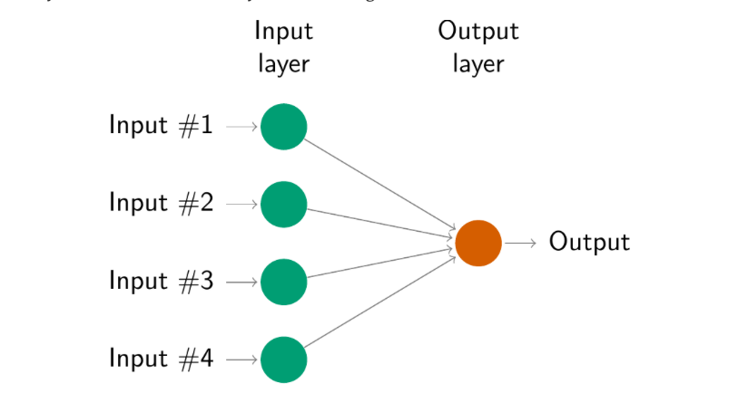

## Simple NN

- The simplest networks contain no hidden layers and are equivalent to linear regressions. 
- Previous figure shows the neural network version of a linear regression with four predictors. 
- The coefficients attached to these predictors are called “weights”. 
- The forecasts are obtained by a linear combination of the inputs. 

## Simple NN

- The weights are selected in the neural network framework using a “learning algorithm” that minimises a “cost function” such as the MSE. 
- In this simple example, we can use linear regression which is a much more efficient method of training the model

## Moving to a more complex NN

- Once we add an intermediate layer with hidden neurons, the neural network becomes non-linear. 
- This is known as a multilayer feed-forward network
- Each layer of nodes receives inputs from the previous layers.

## 

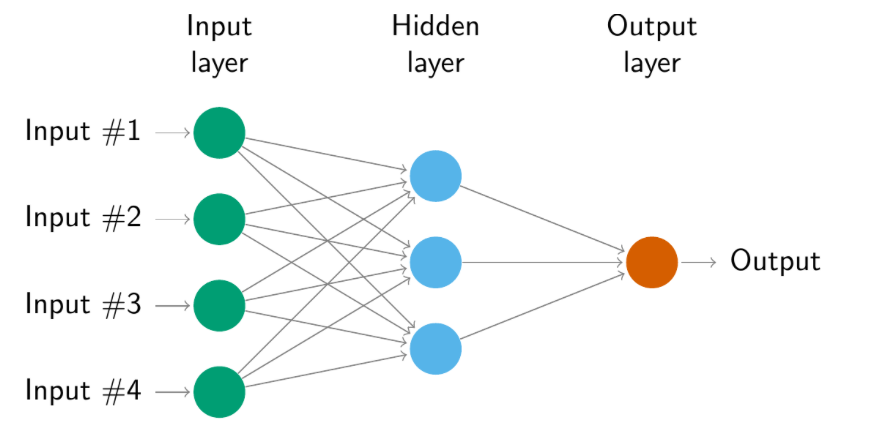

## 

- The inputs into each hidden neuron in previous figure are combined linearly to give
$$
z_j = b_j + \sum_{i=1}^4 w_{i,j} x_i.
$$

- In the hidden layer, this is then modified using a nonlinear function such as:

- Sigmoid:
$$
s(z) = \frac{1}{1+e^{-z}},
$$
- ReLu (rectified linear unit)
$$
f(x) = max(0, x)
$$

## Plots of sigmoid and ReLu functions

```{r, echo=FALSE}
x = seq(-4, 4, .01)
sigmoid = 1 / (1 + exp(-x))
ReLu = pmax(0, x)
plot(range(x), range(sigmoid, ReLu), type = "n", xlab = "", ylab = "", frame = FALSE, ann = FALSE)
abline(h = 0, lty = 'dotted')
abline(v = 0, lty = 'dotted')
lines(sigmoid~x, col = "tomato")
lines(ReLu~x, col = 'blue')
legend("topleft", legend = c("sigmoid", "ReLu"), col = c("tomato", "blue"), lty = 1)
```

##

- The parameters are “learned” (or estimated) from the data.
- The values of the weights can be restricted to prevent them from becoming too large (regularization).
- The parameter that restricts the weights is known as the *decay parameter*
    * the `nnet` engine behind `NNETAR()` defaults to `decay = 0` (no restriction)

##

- The weights take random values to begin with, and these are then updated using the observed data.
- There is an element of randomness in the predictions produced by a neural network.
- Therefore, the network is usually trained several times using different random starting points, and the results are averaged.

##

- The number of hidden layers, and the number of nodes in each hidden layer, must be specified in advance.
- In general these are tuning choices, often selected using a validation set or cross-validation.
    * `NNETAR()` does not tune them: it uses a default rule for the number of nodes (see below), or you can set `n_nodes` yourself.

# Neural network autoregression

## Neural network autoregression

- With time series data, lagged values of the time series can be used as inputs to a neural network
    * just as we used lagged values in a AR(p) model
- This is called a neural network autoregression or _NNAR_ 

## NNAR

- To start, we only consider feed-forward networks with one hidden layer
    * use the notation NNAR(p, k) to indicate there are p lagged inputs and k nodes in the hidden layer
    * For example, a NNAR(9,5) model is a neural network with the last nine observations $y_{t-1}, \ldots, y_{t-9}$ used as inputs for forecasting the output $y_t$ and with five neurons in the hidden layer.
- A NNAR(p, 0) model is equivalent to an ARIMA(p, 0, 0) model, but without the restrictions on the parameters to ensure stationarity.

## Seasonal NNAR

- With seasonal data, it is useful to also add the last observed values from the same season as inputs.
- An NNAR$(3,1,2)_{12}$ model has inputs $y_{t−1}, y_{t−2}, y_{t−3}$, and $y_{t−12}$, and two neurons in the hidden layer.
- More generally, an NNAR$(p,P,k)_m$ model has $(y_{t-1},y_{t-2},\dots,y_{t-p},y_{t-m},y_{t-2m},\dots,y_{t-Pm})$ inputs  and k neurons in the hidden layer.
- A NNAR$(p,P,0)_m$ model is equivalent to an ARIMA$(p,0,0)(P,0,0)_m$ model but without the restrictions on the parameters that ensure stationarity.

## Fitting the model 

- The `NNETAR()` function fits an NNAR$(p,P,k)_m$ model.
- If the values of p and P are not specified, they are selected automatically.
- For non-seasonal time series, the default is the optimal number of lags (according to the AIC) for a linear AR(p) model.
- For seasonal time series, the default values are P=1 and p is chosen from the optimal linear model fitted to the seasonally adjusted data.
- If k is not specified, it is set to k=(p+P+1)/2 (rounded to the nearest integer).

## Forecasting 

- When it comes to forecasting, the network is applied iteratively.
- For forecasting one step ahead, we simply use the available historical inputs.
- For forecasting two steps ahead, we use the one-step forecast as an input, along with the historical data.
- This process proceeds until we have computed all the required forecasts.

# Application

## Sunspots 

- The surface of the sun contains magnetic regions that appear as dark spots.
- These affect the propagation of radio waves, and so telecommunication companies like to predict sunspot activity in order to plan for any future difficulties.
- Sunspots follow a cycle of length between 9 and 14 years.

## Sunspots 

```{r, echo=FALSE}
Sunspots = sunspot.year |> as_tsibble()
ts_plot(Sunspots, title = "Yearly sunspots")
```

## Sunspots 

- We fit the model to the square-root of the counts to stabilize the variance; forecasts are automatically back-transformed.

```{r, eval=TRUE}
#fit <- Sunspots |>
#  model(NNETAR(sqrt(value)))
fit <- readRDS("fit.rds")
print(fit)
```
```{r, eval=TRUE}
#| output-location: slide
fit |>
  forecast(h = 30) |>
  autoplot(Sunspots) +
  labs(x = "Year", y = "Counts", title = "Yearly sunspots")
```

## Looking at fit

- Here, the last 9 observations are used as predictors, and there are 5 neurons in the hidden layer.
- The cyclicity in the data has been modeled well.
- We can also see the asymmetry of the cycles has been captured by the model, where the increasing part of the cycle is steeper than the decreasing part of the cycle.
- This is one difference between an NNAR model and a linear AR model — while linear AR models can model cyclicity, the modeled cycles are always symmetric.

## Prediction Intervals 

- Unlike ARIMA and ETS models, neural networks are not based on a well-defined stochastic model
- it is not straightforward to derive prediction intervals 
- However, we can still compute prediction intervals using simulation where future sample paths are generated using bootstrapped residuals 

## Prediction Intervals

The neural network fitted to the sunspot data can be written as

$$
y_t = f({\bf y}_{t-1}) + \varepsilon_t
$$

where ${\bf y}_{t-1} = (y_{t-1},y_{t-2},\dots,y_{t-9})'$

- We can simulate future sample paths of this model iteratively, by randomly generating a value for $\epsilon_t$
either from a normal distribution, or by resampling from the historical values

## Prediction Intervals

Here is a simulation of 9 possible future sample paths for the sunspot data. Each sample path covers the next 30 years after the observed data.

```{r, eval=TRUE}
#| output-location: slide
fit |>
  generate(times = 9, h = 30) |>
  autoplot(.sim) +
  autolayer(Sunspots, value) +
  theme(legend.position = "none")
```

##

- If we do this many times, we can get a good picture of the forecast distributions. 
- This is how the `forecast()` function produces prediction intervals for NNAR models. 
- The `times` argument in `forecast()` controls how many simulations are done (default 1000). 
- By default, the errors are drawn from a normal distribution. 
- The bootstrap argument allows the errors to be “bootstrapped” (i.e., randomly drawn from the historical errors).

## Is the neural network any better?

- A forecast plot alone doesn't tell us. Hold out the last 30 years and compare against baselines.
- We fit on data through 1958 and forecast 1959–1988: NNAR, ARIMA, and a naive forecast.

```{r, eval=TRUE}
set.seed(123)  # NNAR starts from random weights
train <- Sunspots |> filter(index <= 1958)
fits <- train |>
  model(
    NNAR  = NNETAR(sqrt(value)),
    ARIMA = ARIMA(sqrt(value)),
    Naive = NAIVE(value)
  )
fc <- fits |> forecast(h = 30)
accuracy(fc, Sunspots) |> dplyr::select(.model, RMSE, MAE)
```

## Holdout forecasts

```{r, eval=TRUE}
fc |>
  autoplot(Sunspots |> filter(index > 1900), level = NULL) +
  labs(x = "Year", y = "Counts", title = "Forecasts for 1959-1988")
```

## How much should we trust this?

- On this split NNAR has the lowest error, which fits its ability to capture the asymmetric cycles.
- But this is **one** train/test split of one series, and NNAR depends on random starting weights.
    * Re-running with different seeds gave RMSE roughly between 31 and 39, still below ARIMA (about 42) here.
- A fairer comparison uses rolling-origin cross-validation (`stretch_tsibble()`) and many series.
- Lesson: more flexible models are not automatically better. Always compare against simple baselines on held-out data.

# Recurrent Neural Networks and LSTM

## Recurrent NN

- Thought processes build upon their existing knowledge and understanding 
- They do not start anew with each moment
- NN cannot do this
- Recurrent neural networks address this issue. 
- They are networks with loops in them, allowing information to persist.
- [http://colah.github.io/posts/2015-08-Understanding-LSTMs/]()

## Recurrent NN

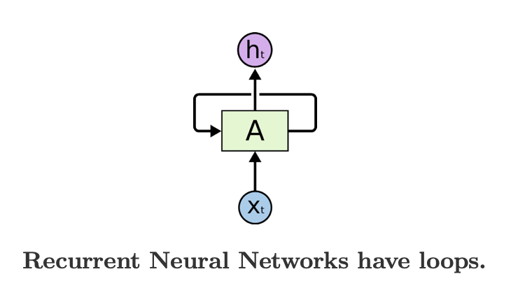

- $A$ a chunk of neural network
- $x_t$ input
- $h_t$ output

## Recurrent NN another way {.smaller}

- These loops make recurrent neural networks seem kind of mysterious. 
- It turns out that they aren’t all that different than a normal neural network. 
- A RNN can be thought of as multiple copies of the same network, each passing a message to a successor. 

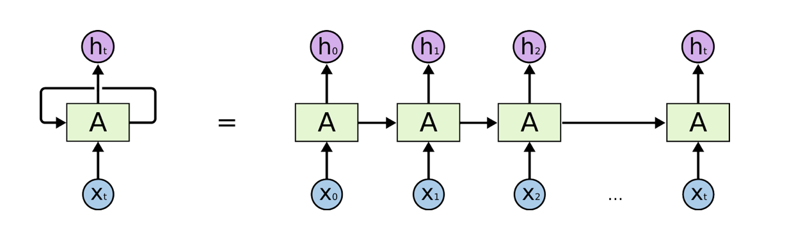

## RNN

- Sometimes, we only need to look at recent information to perform the present task. 
- Consider a language model trying to predict the next word based on the previous ones. 
- For example, "Math is my favorite subject in ________"
- But there are also cases where we need more context (eg. longer lags) 
- "I grew up in Buffalo, NY"... "My favorite football team is ________"


## RNN

- As the gap grows, RNNs become unable to learn to connect the information.

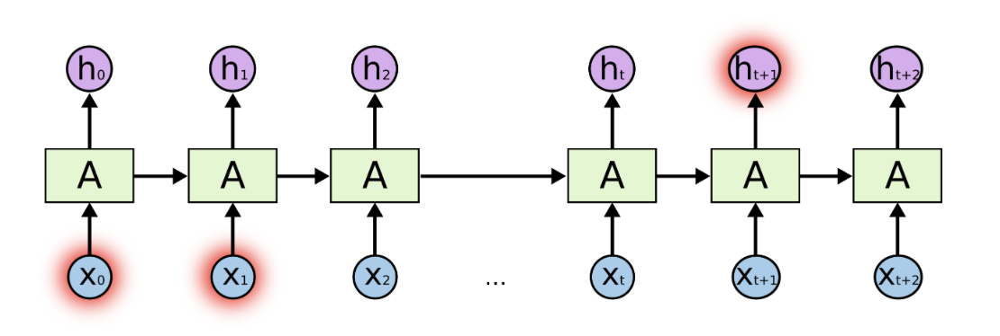

## RNN

- In theory, RNNs are capable of handling such “long-term dependencies.” 
- In practice, RNNs don’t seem to be able to learn them. 
    - Hochreiter (1991) and Bengio, et al. (1994)
- Enter LSTM (Long Short Term Memory Networks)

## Long Short Term Memory Networks

- special kind of RNN, capable of learning long-term dependencies
- LSTMs are explicitly designed to avoid the long-term dependency problem

## Recall the standard RNN

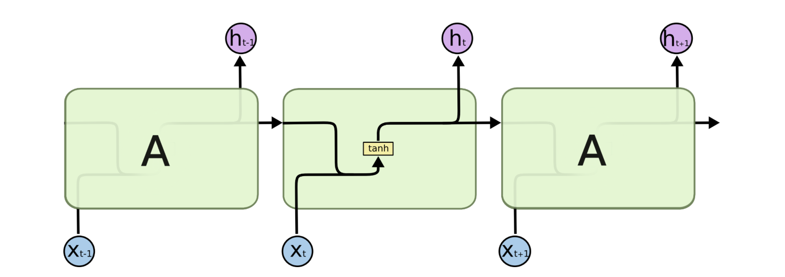

## LSTM diagram

- LSTM adds complexity within each layer
- To forget and retain info

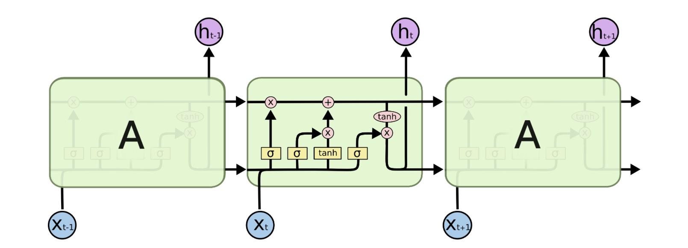

## LSTM {.smaller}

- Each yellow box is a *gate* that controls the flow of new information into the system
    1. Forget Gate
    1. Input Gate
    1. Input Modulation gate
    1. Output Gate


## Some info about the gates {.smaller .scrollable}

1. Forget Gate (f): At forget gate the input is combined with the previous output to generate a fraction between 0 and 1, that determines how much of the previous state need to be preserved (or in other words, how much of the state should be forgotten). This output is then multiplied with the previous state. Note: An activation output of 1.0 means “remember everything” and activation output of 0.0 means “forget everything.” From a different perspective, a better name for the forget gate might be the “remember gate”
1. Input Gate(i): Input gate operates on the same signals as the forget gate, but here the objective is to decide which new information is going to enter the state of LSTM. The output of the input gate (again a fraction between 0 and 1) is multiplied with the output of tan h block that produces the new values that must be added to previous state. This gated vector is then added to previous state to generate current state
1. Input Modulation Gate(g): It is often considered as a sub-part of the input gate and much literature on LSTM’s does not even mention it and assume it is inside the Input gate. It is used to modulate the information that the Input gate will write onto the Internal State Cell by adding non-linearity to the information and making the information Zero-mean. This is done to reduce the learning time as Zero-mean input has faster convergence. Although this gate’s actions are less important than the others and are often treated as a finesse-providing concept, it is good practice to include this gate in the structure of the LSTM unit.
1. Output Gate(o): At output gate, the input and previous state are gated as before to generate another scaling fraction that is combined with the output of tanh block that brings the current state. This output is then given out. The output and state are fed back into the LSTM block.

## Cell State {.smaller}

- A key to LSTMs is the cell state, the horizontal line running through the top of the diagram.
- The cell state is kind of like a conveyor belt. 
- It runs straight down the entire chain, with only some minor linear interactions. 
- It’s very easy for information to just flow along it unchanged.

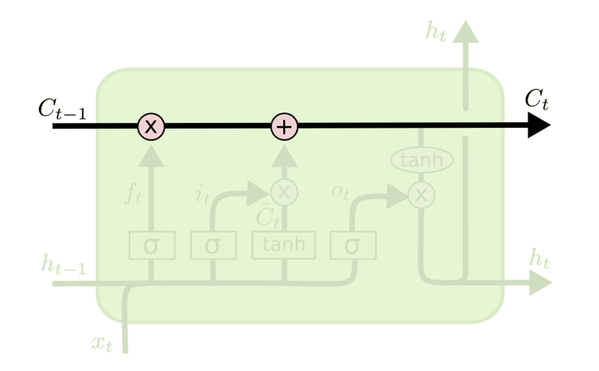

## Cell State 

- LSTM does have the ability to remove or add information to the cell state
- This is done with one of the gates.
- Recall the *sigmoid* activation funtion we discussed previously. 
    * it takes values between 0 and 1.
- A value of zero means “let nothing through”
- A value of one means “let everything through”

## Step-by-Step LSTM Walk Through

1. The first step in our LSTM is to decide what information we’re going to throw away from the cell state. Discussed on previous slides
1. The next step is to decide what new information we’re going to store in the cell state, done in 2 parts
    1. First, a sigmoid layer called the “input gate layer” decides which values we’ll update.
    1. Next, a tanh layer creates a vector of new candidate values, that could be added to the state. 
    - In the next step, we’ll combine these two to create an update to the state.
1. we need to decide what we’re going to output. 
    - A sigmoid layer which decides what parts of the cell state we’re going to output. 
    - Then, we put the cell state through tanh (to push the values to be between −1 and 1) and multiply it by the output of the sigmoid gate

## Step-by-Step LSTM Walk Through

1. 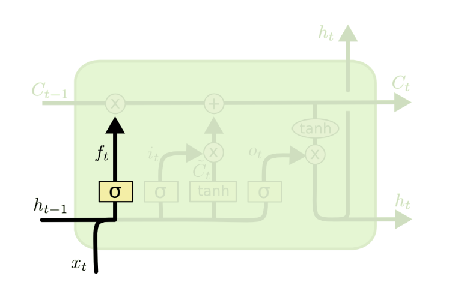
1. 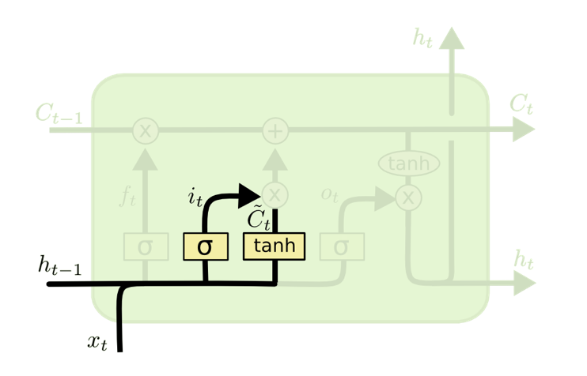
1. 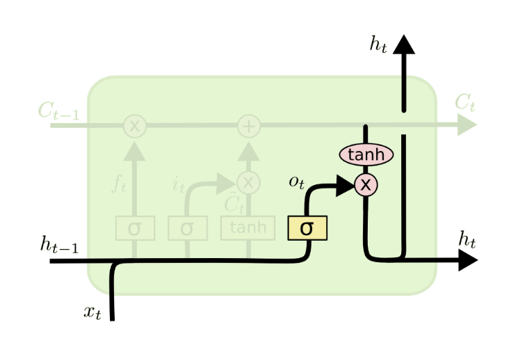

# Neural networks in R: Keras

## Keras

Keras is a high-level API to build and train deep learning models. It’s used for fast prototyping, advanced research, and production, with three key advantages:

- User friendly: Keras has a simple, consistent interface optimized for common use cases. It provides clear and actionable feedback for user errors.
- Modular and composable: Keras models are made by connecting configurable building blocks together, with few restrictions.
- Easy to extend: Write custom building blocks to express new ideas for research. Create new layers, loss functions, and develop state-of-the-art models.

## Keras in R

- The current R interface is the **`keras3`** package, built on Keras 3 (the older `keras` package is superseded).
- Keras 3 runs on several backends (TensorFlow, JAX, PyTorch); `keras3` uses TensorFlow by default.

```{r, eval=FALSE}
install.packages("keras3")
library(keras3)
install_keras()
```

- This sets up a Python environment with Keras and a CPU backend. 
- If you want a more customized installation (e.g. NVIDIA GPUs), see the `keras3` documentation.

::: {.callout-note}
`install_keras()` needs a Python between 3.9 and 3.11. If your default Python is newer (e.g. 3.12+), it will fail with "Suitable Python installation for creating a venv not found". Install Python 3.11 (e.g. `reticulate::install_python("3.11")` or a conda/venv environment), then point R at it with `Sys.setenv(RETICULATE_PYTHON = "path/to/python")` before `library(keras3)`. Check what R sees with `reticulate::py_config()`.
:::

## reticulate: Interface to 'Python'

- `keras3` talks to Python through the `reticulate` package.
- Interface to 'Python' modules, classes, and functions. 
- When calling into 'Python', R data types are automatically converted to their equivalent 'Python' types. 
- When values are returned from 'Python' to R they are converted back to R types. 

## reticulate

```{r}
library(reticulate)
np <- import("numpy", convert=FALSE)
(x <- np$arange(1, 9)$reshape(2L, 2L, 2L))
```
```{r}
(y <- py_to_r(x))
```
- Remember Python’s print order is different. 
- The first “rows” (first index values) are grouped together. 

## Keras 

- The core data structure of Keras is a **model**, a way to organize layers. 
- The simplest type of model is the Sequential model, a linear stack of layers.
- We state the input shape up front, then add layers to the model.

```{r, eval=FALSE}
model <- keras_model_sequential(input_shape = c(9))
```

## Keras layers {.smaller}

- Add a densely-connected NN layer to an output
```{r, eval=FALSE}
layer_dense()
```

- Dropout consists in randomly setting a fraction rate of input units to 0 at each update during training time, which helps prevent overfitting.
```{r, eval=FALSE}
layer_dropout()
```

## A feed-forward network for sunspots {.smaller}

The same idea as NNAR(9, 5): 9 lagged values in, 5 hidden neurons, 1 forecast out.

```{r, eval=FALSE}
model <- keras_model_sequential(input_shape = c(9)) |>
  layer_dense(units = 5, activation = "relu") |>
  layer_dense(units = 1)

model |> compile(optimizer = "adam", loss = "mse")
```

- `x_train` would be a matrix with 9 columns of lagged values (scaled), and `y_train` the next value.

## A simple RNN in Keras {.smaller}

A recurrent layer expects 3-d input: (samples, timesteps, features).

```{r, eval=FALSE}
library(keras3)

model_rnn <- keras_model_sequential(input_shape = c(num_timesteps, num_features)) |>
  layer_simple_rnn(units = 4) |>
  layer_dense(units = 1)

model_rnn |> compile(
  optimizer = "rmsprop",
  loss = "mae"
) # model building

history_rnn <- model_rnn |> fit(
  x_train,
  y_train,
  batch_size = 40,
  epochs = 100,
  validation_split = 0.2
)  # model training

plot(history_rnn)
```

- Swapping `layer_simple_rnn()` for `layer_lstm()` gives an LSTM; nothing else changes.
- `x_train`, `y_train`, `num_timesteps` and `num_features` come from your data: windows of past observations and the value that follows.
